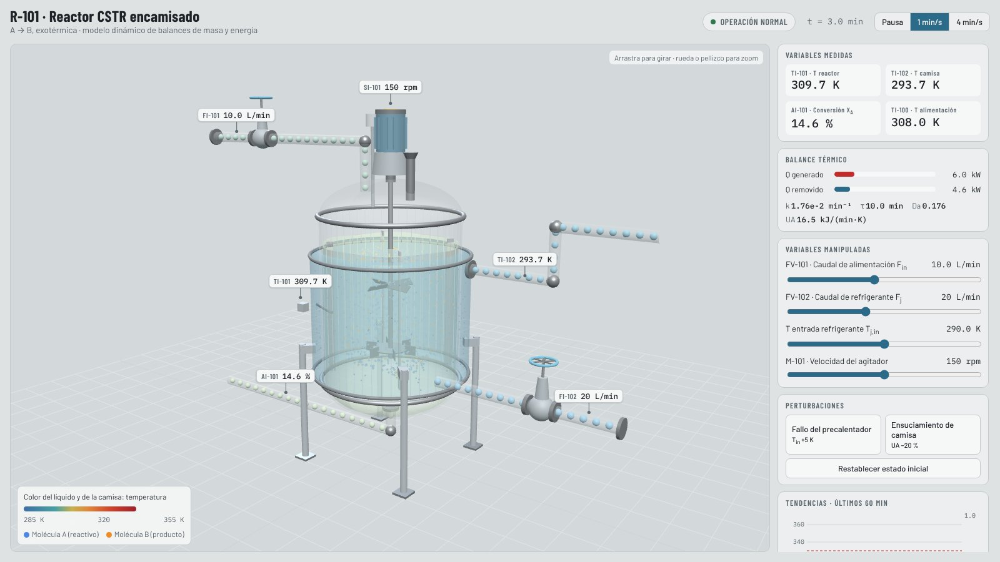
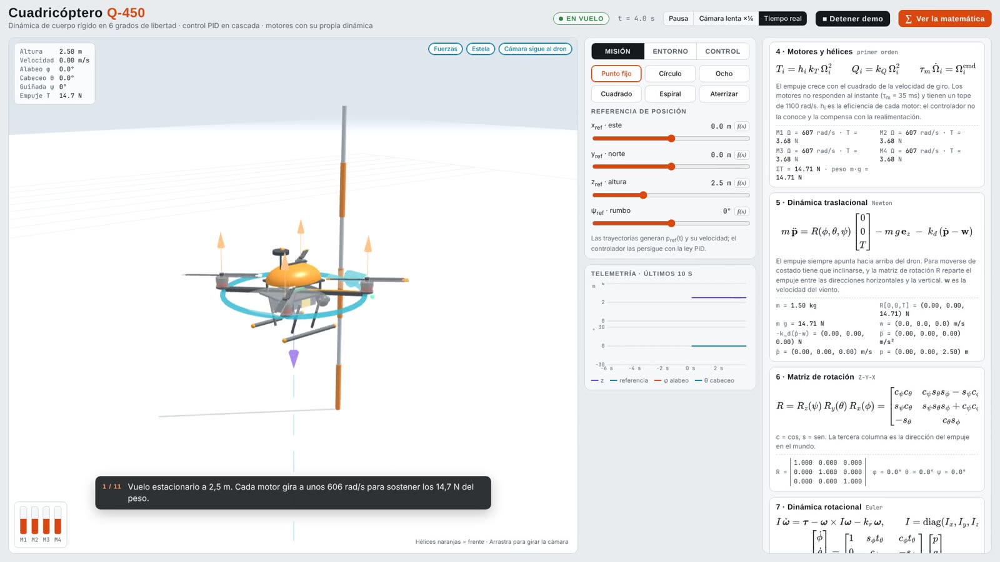
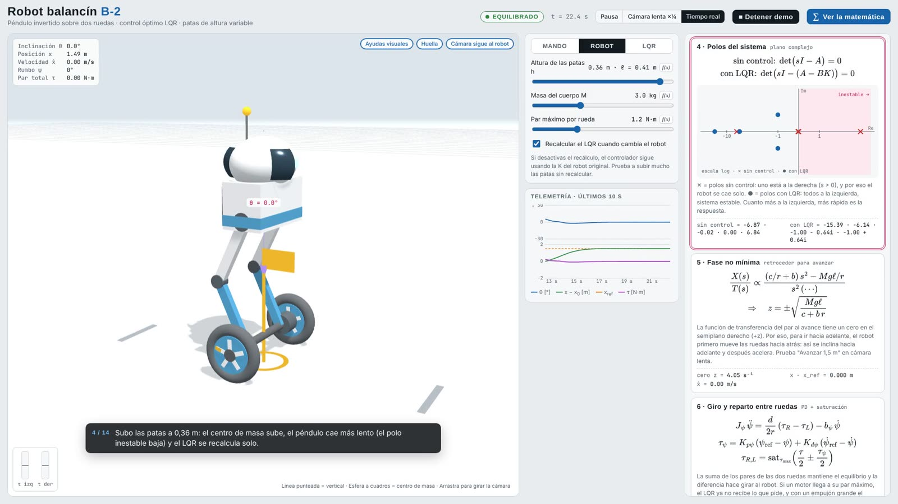
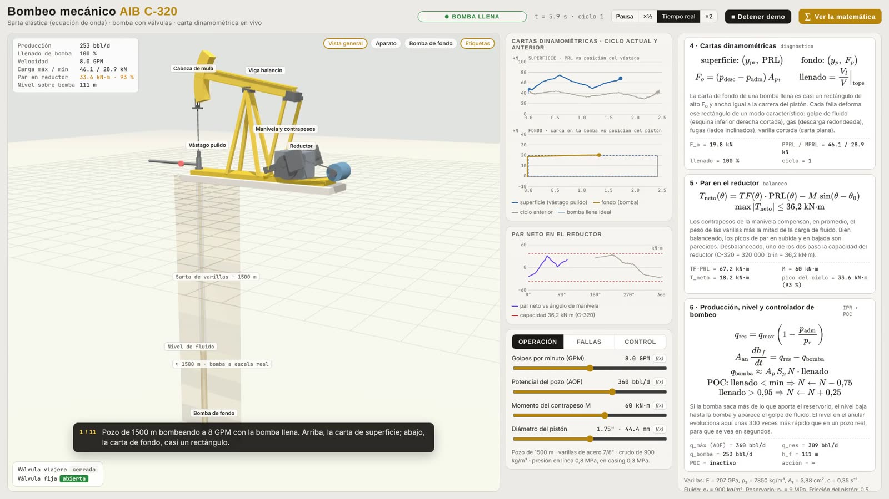
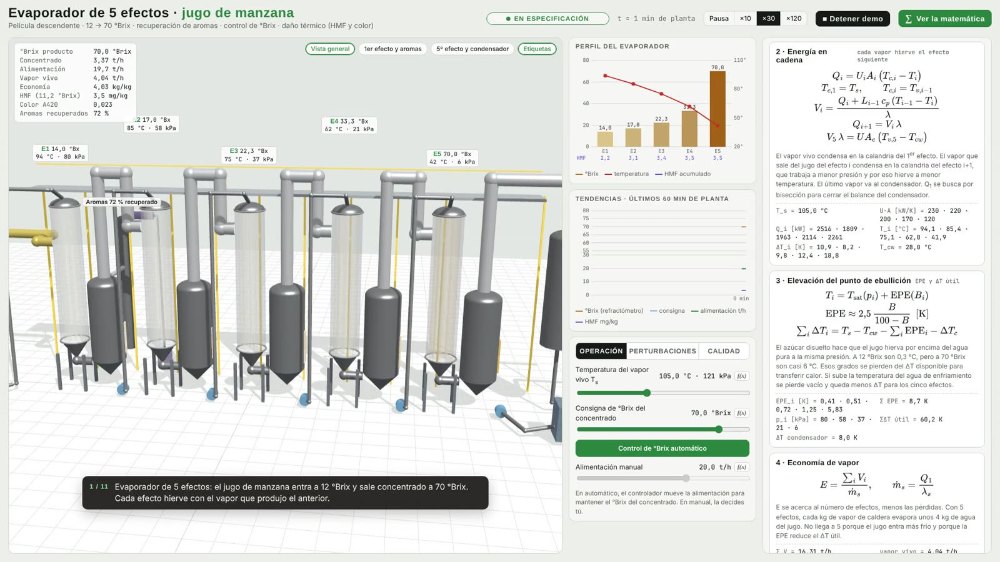

# Simulations3D · Simuladores de procesos y control en 3D

**Sitio en vivo:** https://juanlaigle-hub.github.io/Simulations3D/ · [English version](README.md)

Cinco simuladores físicos interactivos que corren en el navegador, sin instalar nada. Cada uno resuelve su modelo en
tiempo real y la escena 3D sale del estado del modelo. Muestra las ecuaciones con sus valores en vivo y, al mover un
control, resalta el término que cambia. Todos tienen una demo guiada.

| | Simulador | Modelo y control | Abrir |
|---|---|---|---|
|  | **[Reactor CSTR R-101 · HMI de entrenamiento](hmi/)** | Reactor encamisado, reacción exotérmica A → B; balances de masa y energía (RK4), ruido de medición, alarmas; HMI en Dash (estilo ISA-101) conectada a la vista 3D. Caso base 310 K; con la falla del precalentador llega a 339 K si el operador no actúa | [Página 3D](https://juanlaigle-hub.github.io/Simulations3D/hmi/assets/cstr_3d.html) |
|  | **[Cuadricóptero Q-450](drone_3d/)** | Cuerpo rígido de 6 GDL, PID en cascada (posición → actitud), mezclador en X, dinámica de motores; viento con ráfagas, carga desconocida, falla de motor | [Abrir](https://juanlaigle-hub.github.io/Simulations3D/drone_3d/cuadricoptero.html) |
|  | **[Robot balancín B-2](robot_balancin/)** | Péndulo invertido sobre ruedas, no lineal, con patas de altura variable; LQR resuelto en el navegador con los polos de lazo cerrado en vivo | [Abrir](https://juanlaigle-hub.github.io/Simulations3D/robot_balancin/robot.html) |
|  | **[Bombeo mecánico AIB C-320](bombeo_mecanico/)** | Sarta de 1500 m con la ecuación de onda amortiguada, bomba de fondo con cámara de líquido y gas y válvulas por presión; cartas dinamométricas de superficie y de fondo en vivo; 5 fallas; controlador de bombeo (POC) | [Abrir](https://juanlaigle-hub.github.io/Simulations3D/bombeo_mecanico/bombeo.html) |
|  | **[Evaporador de 5 efectos para jugo de manzana](evaporador_jugo/)** | Película descendente, 12 → 70 °Brix; balances por efecto, elevación del punto de ebullición, economía de vapor, control PI del °Brix, recuperación de aromas, daño térmico (HMF y color por Arrhenius), ensuciamiento y CIP | [Abrir](https://juanlaigle-hub.github.io/Simulations3D/evaporador_jugo/evaporador.html) |

## Decisiones de ingeniería

- **El modelo primero.** Cada animación sale del estado del modelo: balances, cinética, dinámica de cuerpo rígido o
  ecuación de onda. Nada se anima a mano.
- **La matemática a la vista, pero opcional.** El panel "∑ Ver la matemática" muestra las ecuaciones con MathJax y sus
  valores en vivo, y resalta la ecuación y el término que afecta el control que se acaba de mover.
- **Chequeos de fenomenología.** Las pruebas físicas encontraron errores reales, corregidos en commits separados:
  - una fuga en la válvula viajera que *aumentaba* la producción, porque el líquido se contaba dos veces;
  - una cadena de energía del evaporador con dos soluciones cerca de 80 °Brix. Se corrigió con un U que depende de la
    viscosidad, un caudal mínimo de mojado y un enclavamiento de °Brix alto.
- **Funciona sin internet.** three.js y MathJax están incluidos en cada carpeta `vendor/`, con respaldo desde un CDN.
- **Base para ML.** Los simuladores de bombeo y del evaporador generan los datos de los proyectos de
  **[MachineLearningApplications](https://github.com/juanlaigle-hub/MachineLearningApplications)**.

## Estructura

```
hmi/                CSTR: modelo en Python, HMI en Dash y página 3D (hmi/assets/cstr_3d.html)
drone_3d/           cuadricóptero
robot_balancin/     robot balancín
bombeo_mecanico/    bombeo mecánico
evaporador_jugo/    evaporador de 5 efectos
assets/             previews
index.html          portada del portafolio (GitHub Pages)
CSTR_Fundamentals.md
```

Cada carpeta tiene su README con las ecuaciones completas, experimentos sugeridos y el guion de la demo.

## Cómo usarlo

Los cuatro simuladores 3D y la página 3D del CSTR son archivos HTML únicos: se abren con doble clic.

La HMI del CSTR corre en Python:

```bash
pip install -r requirements.txt
python hmi/app.py
```

Se abre en `http://127.0.0.1:8050`.

## Notas

- Los simuladores son educativos: los parámetros son representativos, no los de un equipo real en particular.
- Licencia MIT.
