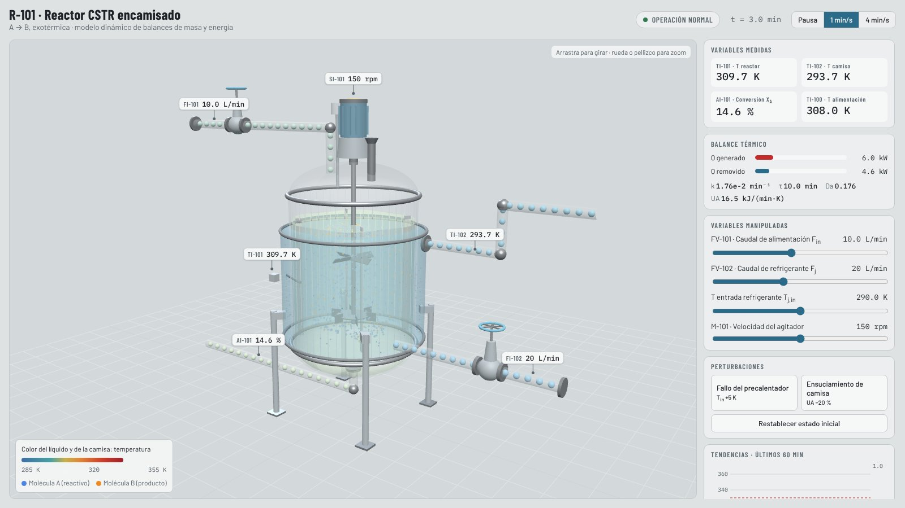
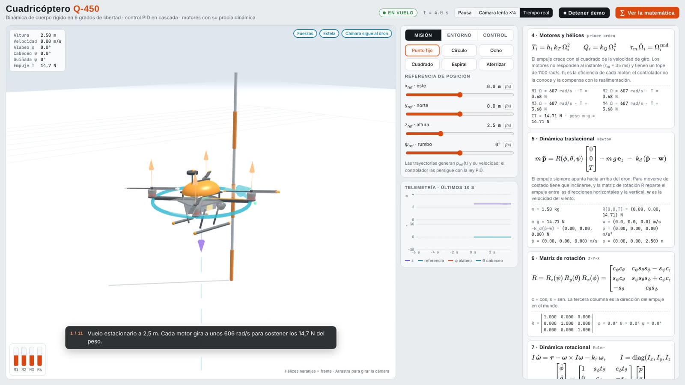
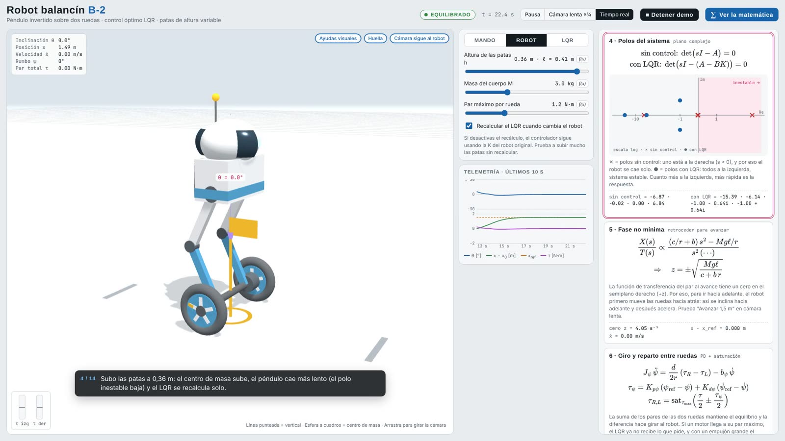
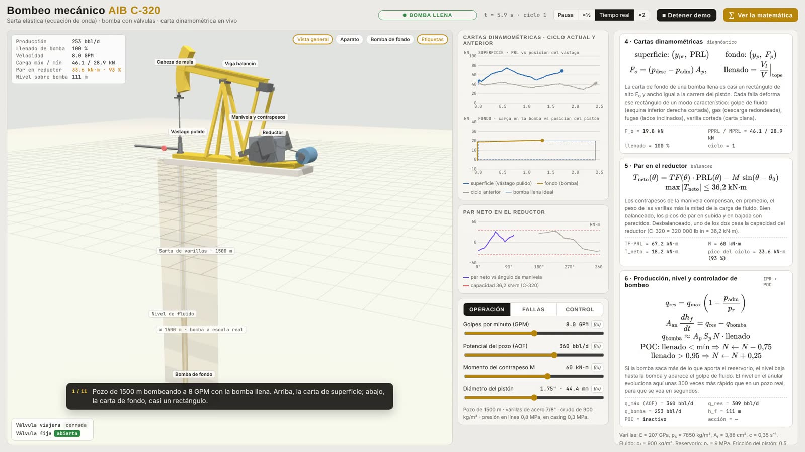
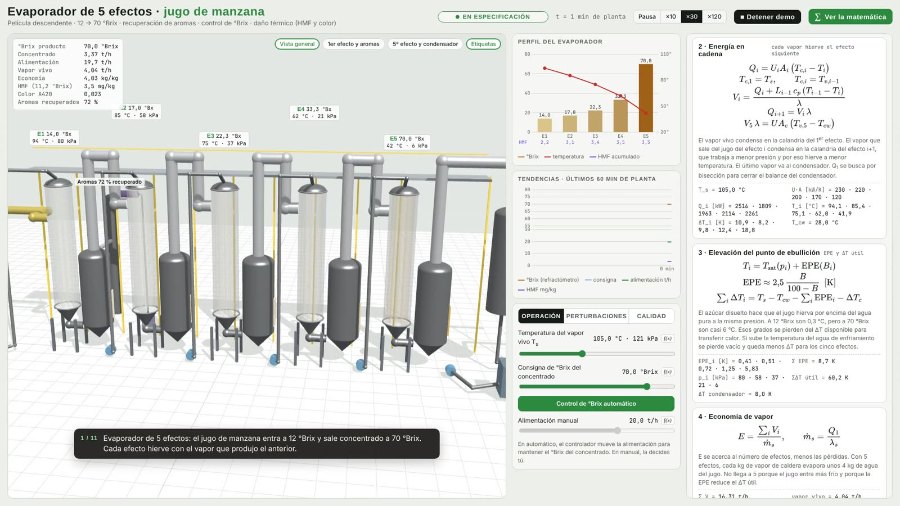

# Simulations3D · Process and control simulators in 3D

[](https://github.com/juanlaigle-hub/Simulations3D/actions/workflows/fisica.yml)

**Live site:** https://juanlaigle-hub.github.io/Simulations3D/ · [Versión en español](README.es.md)

The CSTR reactor demo is open to everyone. The other simulators are confidential: use **Request a demo** to write to me.

Five interactive physics simulators that run in the browser with nothing to install. Each one solves its model in real
time, drives the 3D scene from the model state, shows the equations with live values (the term that changes is
highlighted when you move a control) and has a guided demo.

| | Simulator | Model and control | Open |
|---|---|---|---|
|  | **[CSTR reactor R-101 · training HMI](hmi/)** | Jacketed reactor, exothermic A → B; mass and energy balances (RK4), measurement noise, alarms; Dash HMI (ISA-101 style) linked to the 3D view. Base case 310 K; preheater failure runs away to 339 K unless the operator acts | [3D page](https://juanlaigle-hub.github.io/Simulations3D/hmi/assets/cstr_3d.html) |
|  | **[Q-450 quadcopter](drone_3d/)** | 6-DOF rigid body, cascaded PID (position → attitude), X mixer, motor dynamics; wind gusts, unknown payload, motor failure | [Request a demo](mailto:juanlaigle@gmail.com?subject=Demo%3A%20Q-450%20quadcopter) |
|  | **[B-2 self-balancing robot](robot_balancin/)** | Nonlinear wheeled inverted pendulum with adjustable legs; LQR solved in the browser with live closed-loop poles | [Request a demo](mailto:juanlaigle@gmail.com?subject=Demo%3A%20B-2%20self-balancing%20robot) |
|  | **[Sucker-rod pumping unit C-320](bombeo_mecanico/)** | 1500 m rod string with the damped wave equation, downhole pump with gas/liquid chamber and pressure-driven valves; live surface and downhole dynamometer cards; 5 faults; pump-off controller | [Request a demo](mailto:juanlaigle@gmail.com?subject=Demo%3A%20Sucker-rod%20pumping%20unit%20C-320) |
|  | **[5-effect apple juice evaporator](evaporador_jugo/)** | Falling film, 12 → 70 °Brix; per-effect balances, boiling-point elevation, steam economy, PI °Brix control, aroma recovery, thermal damage (HMF and colour via Arrhenius), fouling and CIP | [Request a demo](mailto:juanlaigle@gmail.com?subject=Demo%3A%205-effect%20apple%20juice%20evaporator) |

## Engineering decisions

- **Model first.** Every animation comes from the model state (balances, kinetics, rigid-body dynamics, wave
  equation). Nothing is animated by hand.
- **Math in view, but optional.** The "∑ Show the math" panel renders the equations with MathJax and live values, and
  highlights the equation and the term affected by the control you just moved.
- **Phenomenology checks.** Physics tests caught real bugs, fixed in separate commits: a travelling-valve leak that
  *increased* production (double counting), and an evaporator energy chain with two solutions near 80 °Brix (fixed
  with viscosity-dependent U, a minimum wetting rate and a high-°Brix interlock).
- **Works offline.** three.js and MathJax are bundled in each `vendor/` folder, with a CDN fallback.
- **Basis for ML.** The pumping and evaporator simulators generate the data for the projects in
  **[MachineLearningApplications](https://github.com/juanlaigle-hub/MachineLearningApplications)**.

## Layout

```
hmi/                CSTR: Python model, Dash HMI and the 3D page (hmi/assets/cstr_3d.html)
drone_3d/           quadcopter
robot_balancin/     self-balancing robot
bombeo_mecanico/    sucker-rod pumping
evaporador_jugo/    5-effect evaporator
assets/             previews
index.html          portfolio landing page (GitHub Pages)
CSTR_Fundamentals.md
```

Each folder has its own README (in English, with a Spanish version) with the full equations, suggested experiments and the demo script.

## Physics tests

Every push runs automated phenomenology checks (`tests/`) that load each simulator's physics core straight from its HTML and verify what the READMEs claim:

| Model | What is checked |
|---|---|
| CSTR | Exact base steady state (310 K, X = 0.15), thermal stability at the operating point, runaway to 339 K after the preheater failure and recovery to 316 K |
| Quadcopter | Stable hover, integral action with an unknown payload, stability limit $K_d > \tau_m K_p$ from motor lag, recovery from a push, crash detection that disarms the motors |
| Self-balancing robot | Open-loop pole moves toward the origin with taller legs, stable LQR closed loop, ~3 cm non-minimum-phase undershoot, torque saturation |
| Sucker-rod pump | Fluid load $F_o$ = 17.9 kN, production and peak load, gearbox torque vs. counterbalance, valve leak lowers production, parted rod stops it |
| Evaporator | 70 °Brix steady state, solids balance, steam economy, BPE and $T_{sat}$ references, feed/steam step directions, HMF rises with steam temperature |

```bash
node --test tests/fisica.test.mjs
python -m unittest discover -s tests
```

## Run

The four 3D simulators and the CSTR 3D page are single HTML files: open them with a double click.

The CSTR HMI runs in Python:

```bash
pip install -r requirements.txt
python hmi/app.py
```

It opens at `http://127.0.0.1:8050`.

## Notes

- The simulators are educational: parameters are representative, not those of a specific real unit.
- MIT license.
