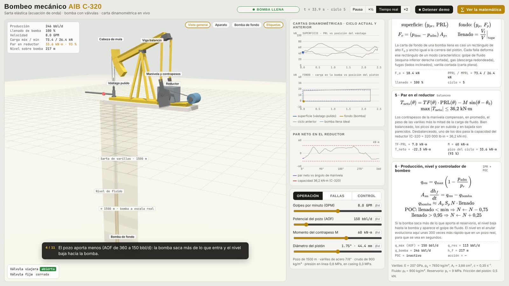

# Bombeo mecánico AIB C-320 · carta dinamométrica en vivo

Simulador 3D de un pozo con bombeo mecánico: aparato individual de bombeo (AIB), sarta de varillas de 1500 m y bomba de fondo con sus válvulas. La sarta se modela como un sólido elástico con la **ecuación de onda amortiguada**. La bomba tiene una cámara con líquido y gas, y válvulas que abren y cierran según las presiones. Con eso se obtienen la **carta dinamométrica de superficie y la de fondo** en tiempo real, igual que las que mide un dinamómetro en el campo.

 

## Cómo abrirlo

Abre `bombeo.html` en el navegador con doble clic. three.js y MathJax están incluidos en `vendor/`, así que funciona sin internet.

- **"▶ Demo guiada":** reproduce una secuencia guiada con subtítulos.
- **"∑ Ver la matemática":** abre el panel con las ecuaciones y sus valores en vivo.
- **Vistas de cámara:** vista general, aparato y bomba de fondo.

| Pestaña | Qué se puede mover |
|---|---|
| **Operación** | Golpes por minuto, potencial del pozo (AOF), momento del contrapeso, diámetro del pistón |
| **Fallas** | Gas libre en la admisión, fuga en válvula viajera, fuga en válvula fija, varilla cortada, golpe abajo, reparar todo |
| **Control** | Controlador de bombeo (POC) con llenado mínimo aceptado |

Lo que se ve en 3D:
- **Aparato:** la viga cabeceando, las bielas, la manivela con los contrapesos, el reductor, el motor, la brida, el vástago pulido y el flujo en la línea.
- **Pozo en corte:** la sarta coloreada según su tensión (azul = baja, rojo = alta) y el nivel de fluido en el anular. La profundidad está comprimida; la bomba, en cambio, está a escala real.
- **Bomba:** el pistón, la cámara con líquido y gas, y las bolas de las válvulas fija y viajera, que se encienden en verde al abrir.

---

## 1. Cinemática del aparato (mecanismo de 4 barras)

Coordenadas en el plano del aparato: el cojinete central (pivote de la viga) está en $(0, H)$ y el eje de la manivela en $(I, 0)$. Para cada ángulo de manivela $\theta$, el ángulo de la viga $\beta$ sale de que la biela tiene longitud fija $P$:

$$
\big\lVert \mathbf E(\beta) - \mathbf C(\theta) \big\rVert = P,
\qquad
\mathbf E = \begin{bmatrix} C\cos\beta \\ H + C\sin\beta \end{bmatrix},
\qquad
\mathbf C = \begin{bmatrix} I + R\cos\theta \\ R\sin\theta \end{bmatrix}
$$

La ecuación se resuelve por bisección y se tabula en 720 puntos. La cabeza de mula es un arco de radio $A$, así que el vástago pulido se mueve en vertical:

$$
y_{\text{pr}}(\theta) = -A\,\beta(\theta) - y_{\min},
\qquad \theta = \omega t, \quad \omega = \frac{2\pi N}{60}
$$

El **factor de torque** es $TF(\theta) = dy_{\text{pr}}/d\theta$, en metros por radián.

| Cota | Valor | Descripción |
|---|---|---|
| $A$ | 3,0 m | pivote a cabeza de mula |
| $C$ | 2,4 m | pivote a compensador |
| $P$ | 3,3 m | largo de la biela |
| $R$ | 0,95 m | radio de manivela |
| $I$ | 2,4 m | distancia horizontal pivote–eje de manivela |
| $H$ | 3,3 m | altura del pivote sobre el eje de manivela |

La carrera resultante del vástago pulido es de 2,45 m.

## 2. Sarta de varillas: ecuación de onda amortiguada (Gibbs)

Sea $u(x,t)$ el desplazamiento axial de la varilla en la profundidad $x$ (positivo hacia abajo):

$$
\frac{\partial^2 u}{\partial t^2} = v^2\,\frac{\partial^2 u}{\partial x^2} - c\,\frac{\partial u}{\partial t} + g\left(1 - \frac{\rho_f}{\rho_s}\right),
\qquad v = \sqrt{\frac{E}{\rho_s}} \approx 5135\ \text{m/s}
$$

El último término es el peso de las varillas sumergidas en el fluido. Condiciones de borde:

$$
u(0,t) = -y_{\text{pr}}(t)
\qquad\qquad
E A_r \left.\frac{\partial u}{\partial x}\right|_{x=L} = F_p(t)
$$

En superficie se impone el movimiento del aparato. En el fondo, la tensión de la varilla es igual a la carga de la bomba. La carga en el vástago pulido es

$$
\text{PRL}(t) = E A_r \left.\frac{\partial u}{\partial x}\right|_{x=0}
$$

### Discretización

Se usan diferencias finitas explícitas centradas, con $N = 50$ tramos ($\Delta x$ = 30 m) y $\Delta t$ = 1 ms:

$$
u_i^{n+1} = \frac{2u_i^n - \left(1 - \tfrac{c\Delta t}{2}\right)u_i^{n-1} + r\left(u_{i+1}^n - 2u_i^n + u_{i-1}^n\right) + \Delta t^2\, g_{\text{ef}}}{1 + \tfrac{c\Delta t}{2}},
\qquad r = \left(\frac{v\,\Delta t}{\Delta x}\right)^2
$$

El número de Courant es $v\Delta t/\Delta x \approx 0{,}17 < 1$, así que el esquema es estable. En el fondo se usa un nodo fantasma: $u_{N+1} = u_{N-1} + 2\Delta x\,F_p/(EA_r)$. El PRL se calcula con una derivada de segundo orden hacia adelante.

Las ondas de tensión tardan $L/v \approx 0{,}29$ s en recorrer la sarta. Por eso la carta de superficie es una versión "filtrada y retrasada" de la carta de fondo, con oscilaciones sobre el peso de las varillas.

## 3. Bomba de fondo

La cámara entre la válvula fija y el pistón tiene un volumen $V = A_p\,(y_p - y_0)$. Contiene líquido $V_l$ (incompresible) y gas, con $p\,V_g = n_g$ constante (isotérmico):

$$
p_{\text{cám}} = \frac{n_g}{V - V_l}
$$

Presiones de referencia:

$$
p_{\text{desc}} = \rho_f g L + p_{\text{línea}} \approx 14{,}0\ \text{MPa},
\qquad
p_{\text{adm}} = p_{\text{casing}} + \rho_f g\,h_f
$$

Lógica de válvulas, que se evalúa en cada paso:
- **Válvula fija** (abajo): abre si $p_{\text{cám}} < p_{\text{adm}}$. Entra mezcla del anular, con fracción $1-\alpha$ de líquido y $\alpha$ de gas, hasta igualar $p_{\text{adm}}$. Si el nivel en el anular llegó a la bomba, solo entra lo que aporta el reservorio.
- **Válvula viajera** (en el pistón): abre si $p_{\text{cám}} > p_{\text{desc}}$. Primero sale el líquido hacia la tubería; si no queda líquido, también sale gas.
- **Fugas:** $\dot V = k\,\Delta p$ a través de la válvula cerrada. La presión se limita al rango físico $[p_{\text{adm}}, p_{\text{desc}}]$ para que el paso explícito no sobrecorrija con el líquido casi incompresible.

Carga en el fondo de la sarta:

$$
F_p = (p_{\text{desc}} - p_{\text{cám}})\,A_p \pm F_{\text{roz}}
$$

Cuando se activa "golpe abajo", se suma una fuerza de contacto si el pistón llega al tope inferior.

**Espaciado de la bomba:** al arrancar, el simulador hace dos ciclos de asentamiento, mide el punto más bajo que alcanza el pistón con la sarta estirada y ubica el tope de la bomba 30 cm por debajo, como se hace en el campo.

## 4. Cartas dinamométricas

- **Superficie:** $(y_{\text{pr}}, \text{PRL})$, lo que mide un dinamómetro en el vástago pulido.
- **Fondo:** $(y_p, F_p)$, la carga y la posición del pistón. En el campo se calcula a partir de la de superficie resolviendo la ecuación de onda hacia atrás; aquí sale directamente de la simulación.

Con bomba llena, la carta de fondo es casi un rectángulo de alto $F_o = (p_{\text{desc}} - p_{\text{adm}})A_p$ y ancho igual a la carrera del pistón. El llenado se mide al tope de cada carrera:

$$
\text{llenado} = \left.\frac{V_l}{V}\right|_{\text{tope}}
$$

| Situación | Carta de fondo |
|---|---|
| Bomba llena | Rectángulo |
| Golpe de fluido | La carga se mantiene durante parte de la bajada y cae de golpe cuando el pistón toca el líquido: esquina inferior derecha cortada |
| Interferencia de gas | La carga baja de forma gradual al comprimirse el gas: descarga redondeada |
| Fuga en válvula viajera | La carga se pierde durante la subida |
| Fuga en válvula fija | La carga tarda en bajar durante la descarga |
| Varilla cortada | Sin carga de fluido: la carta de superficie queda en el peso de la sarta superior |

## 5. Par en el reductor y balanceo

$$
T_{\text{neto}}(\theta) = TF(\theta)\cdot\text{PRL}(\theta) - M\,\sin(\theta - \theta_0)
$$

$M$ es el momento máximo de los contrapesos, y $\theta_0$ se alinea con el máximo del factor de torque. Es la forma de la norma API 11E con el desbalance estructural $B$ igual a cero. La capacidad del reductor C-320 es de 320 000 lb·in, es decir, 36,2 kN·m. Con $M \approx$ 60 kN·m los picos quedan parecidos: unos 34 kN·m en la subida y 27 kN·m en la bajada. Con $M$ = 25 kN·m el pico pasa los 50 kN·m.

## 6. Producción, nivel de fluido y controlador de bombeo (POC)

El reservorio se modela con una IPR lineal:

$$
q_{\text{res}} = q_{\max}\left(1 - \frac{p_{\text{adm}}}{p_r}\right), \qquad p_r = 9\ \text{MPa}
$$

El nivel en el anular sale del balance entre lo que entra y lo que saca la bomba:

$$
A_{\text{an}}\,\frac{dh_f}{dt} = q_{\text{res}} - q_{\text{bomba}}
$$

$A_{\text{an}}$ es un área efectiva unas 300 veces menor que la real, para que el nivel cambie en segundos y no en horas. Si la bomba saca más de lo que aporta el pozo, $h_f$ llega a 0 y aparece el golpe de fluido.

**POC:** en cada tope de carrera compara el llenado con el mínimo aceptado.

$$
\text{llenado} < \text{mín} \Rightarrow N \leftarrow N - 0{,}75\ \text{GPM},
\qquad
\text{llenado} > 0{,}95 \Rightarrow N \leftarrow N + 0{,}25
$$

$N$ queda entre 4 GPM y el valor de operación, y el variador cambia la velocidad con una rampa de 0,8 GPM/s.

## 7. Datos del pozo

| Parámetro | Valor |
|---|---|
| Profundidad de la bomba $L$ | 1500 m |
| Varillas | acero 7/8" ($A_r$ = 3,88 cm², $E$ = 207 GPa, $\rho_s$ = 7850 kg/m³) |
| Amortiguamiento $c$ | 0,35 s⁻¹ |
| Pistón | 1,75" (44,5 mm), ajustable de 1,25" a 2,25" |
| Fluido | $\rho_f$ = 900 kg/m³ |
| Presiones | línea 0,8 MPa, casing 0,3 MPa, reservorio 9 MPa |
| Fricción del pistón | 0,5 kN |
| Operación de referencia | 8 GPM, ≈ 250 bbl/d, PRL 73 / 26 kN |

## Archivos

- `bombeo.html`: el simulador completo.
- `vendor/`: three.js r128 (MIT) y MathJax 3.2.2 (Apache 2.0).
