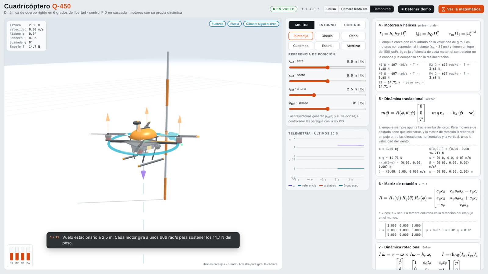
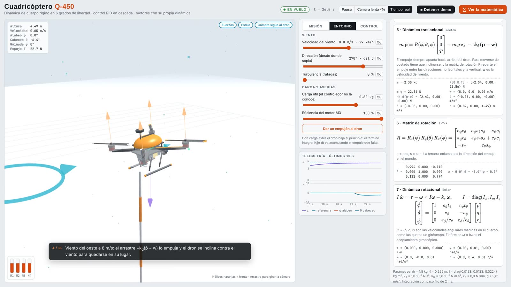

# Q-450 quadcopter · 3D simulator with the math in view

[Versión en español](README.es.md)

Interactive simulator of a 450 mm quadcopter. It uses 6-degree-of-freedom rigid-body dynamics, cascaded PID control and motors with their own dynamics. The 3D scene (three.js) shows the drone, the force on each motor, the reference, the trail and the wind. An optional panel, **"∑ Show the math"**, shows the equations in this document with their live values. When any control moves, the panel highlights in pink the equation and the term that changes.

## How to open it

Open `cuadricoptero.html` in a browser with a double click. No server or installation needed. three.js and MathJax are bundled in `vendor/`, so it works offline. If a local file is missing, it is loaded from a CDN.

The **"▶ Guided demo"** button plays a 76 s sequence with captions. It climbs, adds payload, turns on wind, gives pushes with good and bad damping, simulates a motor failure and flies a circle, all with the equation panel open.

<p> </p>

| Tab | What can be changed |
|---|---|
| **Mission** | Fixed point (x, y, altitude, heading) or trajectories: circle, figure eight, square, spiral; land and take off |
| **Environment** | Wind (speed, direction, gusts), payload unknown to the controller, efficiency of motor M3, push |
| **Control** | The 8 PID gains; shows $\omega_n$ and $\zeta$ of the attitude loop |

Suggested experiments:

1. **Integral action:** with 0.8 kg of payload the drone sinks at first and the term $K_i\int e\,dt$ recovers the altitude within a few seconds. With $K_i = 0$ a steady-state error remains.
2. **Damping and motor lag:** with $K_{d,\eta}$ = 11 the drone oscillates several times after a push. Below $\tau_m K_{p,\eta} \approx 6.3$ the loop is unstable: the drone flips, crashes and the motors disarm. If $K_{d,\eta}$ is raised a lot, the response becomes slow.
3. **Loop separation:** with a low $K_{p,\eta}$ and a high horizontal $K_p$, the inner loop is no longer faster than the outer one and the position becomes unstable.
4. **Motor fault:** with M3 at 60 %, the mixer asks more of M3 until it saturates and the other motors compensate. The motor bars show it.
5. **Gusty wind:** at 10 m/s with 60 % turbulence, the drone leans into the wind and the horizontal integral compensates the mean drag.

---

## 1. Reference frames

- **World (ENU):** $x$ east, $y$ north, $z$ up.
- **Body (FLU):** $x_b$ forward, $y_b$ left, $z_b$ up from the drone.
- **Attitude:** Euler angles $\boldsymbol\eta = (\phi, \theta, \psi)$: roll, pitch and yaw, in Z-Y-X sequence.

The rotation matrix from body to world is

$$
R = R_z(\psi)\,R_y(\theta)\,R_x(\phi) =
\begin{bmatrix}
c_\psi c_\theta & c_\psi s_\theta s_\phi - s_\psi c_\phi & c_\psi s_\theta c_\phi + s_\psi s_\phi \\
s_\psi c_\theta & s_\psi s_\theta s_\phi + c_\psi c_\phi & s_\psi s_\theta c_\phi - c_\psi s_\phi \\
-s_\theta & c_\theta s_\phi & c_\theta c_\phi
\end{bmatrix}
$$

with $c = \cos$ and $s = \sin$. The third column is the thrust direction in the world frame. With $\theta > 0$ the nose drops and the drone accelerates forward. With $\phi > 0$ it banks to the right and accelerates along $-y_b$.

## 2. Motors and propellers

Each motor $i$ spins at $\Omega_i$ [rad/s] and produces a thrust and a reaction torque:

$$
T_i = h_i\,k_T\,\Omega_i^2 \qquad Q_i = k_Q\,\Omega_i^2
$$

$h_i$ is the motor efficiency (1 when healthy). The motor responds as a first-order system with saturation:

$$
\tau_m\,\dot\Omega_i = \Omega_i^{\text{cmd}} - \Omega_i, \qquad 0 \le \Omega_i \le \Omega_{\max}
$$

## 3. Mixer (X configuration)

The motors sit at $\pm d$ on both body axes, with $d = \ell/\sqrt{2}$:

| Motor | Position | Spin (seen from above) |
|---|---|---|
| M1 | front-right $(d, -d)$ | counter-clockwise |
| M2 | rear-left $(-d, d)$ | counter-clockwise |
| M3 | front-left $(d, d)$ | clockwise |
| M4 | rear-right $(-d, -d)$ | clockwise |

Total thrust and body torques follow from $\boldsymbol\tau = \sum \mathbf r_i \times \mathbf F_i$ plus the reaction torques:

$$
\begin{bmatrix} T \\ \tau_\phi \\ \tau_\theta \\ \tau_\psi \end{bmatrix} =
\begin{bmatrix} 1 & 1 & 1 & 1 \\ -d & d & d & -d \\ -d & d & -d & d \\ -c & -c & c & c \end{bmatrix}
\begin{bmatrix} T_1 \\ T_2 \\ T_3 \\ T_4 \end{bmatrix},
\qquad c = \frac{k_Q}{k_T}
$$

The rows of the matrix are orthogonal, so the inverse is direct. The controller uses it to go from $(T, \boldsymbol\tau)$ to the thrust of each motor:

$$
T_i^{\text{cmd}} = \frac{T}{4} + \frac{a_{2i}}{4d^2}\,\tau_\phi + \frac{a_{3i}}{4d^2}\,\tau_\theta + \frac{a_{4i}}{4c^2}\,\tau_\psi,
\qquad \Omega_i^{\text{cmd}} = \sqrt{T_i^{\text{cmd}}/k_T}
$$

where $a_{ji}$ are the matrix elements. If any $T_i^{\text{cmd}}$ falls outside $[0, T_{\max}]$, the collective thrust is shifted first and, if that is not enough, the torques are scaled down in the same proportion. Attitude control thus takes priority over altitude, as in real flight controllers. In that case the status changes to "Motors saturated".

If the drone touches the ground tilted more than 50° or faster than 4 m/s, it counts as a crash: the motors disarm, the drone rests on the ground and a "Restart flight" button appears.

## 4. Translational dynamics (Newton)

$$
m\,\ddot{\mathbf p} = R\begin{bmatrix}0\\0\\T\end{bmatrix} - m\,g\,\mathbf e_z - k_d\,(\dot{\mathbf p} - \mathbf w)
$$

$\mathbf w$ is the wind velocity: a mean value plus gusts generated with an Ornstein–Uhlenbeck process:

$$
\dot{\mathbf w}_g = -\frac{\mathbf w_g}{\tau_g} + \sigma\sqrt{\frac{2}{\tau_g}}\;\boldsymbol\xi(t)
$$

$\boldsymbol\xi(t)$ is white noise and $\tau_g$ = 1.2 s.

## 5. Rotational dynamics (Euler)

$$
I\,\dot{\boldsymbol\omega} = \boldsymbol\tau - \boldsymbol\omega \times I\boldsymbol\omega - k_r\,\boldsymbol\omega,
\qquad I = \operatorname{diag}(I_x, I_y, I_z)
$$

$\boldsymbol\omega = (p, q, r)$ are the body angular rates, the ones a gyroscope would measure. The Euler angles evolve as

$$
\begin{bmatrix}\dot\phi\\ \dot\theta\\ \dot\psi\end{bmatrix} =
\begin{bmatrix} 1 & s_\phi t_\theta & c_\phi t_\theta \\ 0 & c_\phi & -s_\phi \\ 0 & s_\phi / c_\theta & c_\phi / c_\theta \end{bmatrix}
\begin{bmatrix} p\\ q\\ r\end{bmatrix}
$$

with $t = \tan$. The matrix is singular at $\theta = \pm 90°$. That is why the simulation does not integrate the angles: it integrates the rotation matrix, $\dot R = R\,[\boldsymbol\omega]_\times$, re-orthonormalizes it at every step and derives the angles from $R$. The drone can flip over without the numbers breaking down.

## 6. Cascaded control

```
p_ref ──► position PID ──► (T, φ_d, θ_d) ──► attitude PD ──► τ ──► Mixer ──► Ω_i ──► Dynamics ──┐
  ▲                                                                                            │
  └──────────────────────────────── p, ṗ, η, ω (feedback) ─────────────────────────────────────┘
```

### 6.1 Outer loop: position (PID)

$$
\mathbf e = \mathbf p_{\text{ref}} - \mathbf p
$$

$$
\mathbf a_{\text{des}} = K_p\,\mathbf e + K_i\int \mathbf e\,dt - K_d\,(\dot{\mathbf p} - \dot{\mathbf p}_{\text{ref}})
$$

Separate gains are used for the horizontal plane and for altitude. The derivative acts on the measured velocity rather than on the error, so a step in the reference does not cause a derivative kick. The integral is bounded (anti-windup) and frozen while the drone rests on the ground.

The desired acceleration is converted into thrust and angles. It is first rotated into the drone's heading frame:

$$
a_f = a_x\cos\psi + a_y\sin\psi, \qquad a_l = -a_x\sin\psi + a_y\cos\psi
$$

and then:

$$
T_{\text{cmd}} = \frac{\hat m\,(g + a_z)}{\cos\phi\,\cos\theta},
\qquad \theta_d = \arctan\frac{a_f}{g + a_z},
\qquad \phi_d = -\arctan\frac{a_l}{g + a_z}
$$

$\hat m$ = 1.5 kg is the mass the controller **believes** the drone has. When payload is added, the difference $m - \hat m$ is corrected by the altitude integral term.

### 6.2 Inner loop: attitude (PD)

$$
\boldsymbol\tau_{\text{cmd}} = I\left[K_{p,\eta}\,(\boldsymbol\eta_d - \boldsymbol\eta) - K_{d,\eta}\,\boldsymbol\omega\right]
$$

For small angles ($\boldsymbol\omega \approx \dot{\boldsymbol\eta}$), each axis behaves as a second-order system:

$$
\ddot e + K_{d,\eta}\,\dot e + K_{p,\eta}\,e = 0
\quad\Rightarrow\quad
\omega_n = \sqrt{K_{p,\eta}}, \qquad \zeta = \frac{K_{d,\eta}}{2\sqrt{K_{p,\eta}}}
$$

With the default values ($K_{p,\eta}$ = 180, $K_{d,\eta}$ = 22) this gives $\omega_n \approx$ 13.4 rad/s and $\zeta \approx$ 0.82.

The motors do not respond instantly (τ<sub>m</sub> = 35 ms). With that lag the error equation becomes third order:

$$
\tau_m\,\dddot e + \ddot e + K_{d,\eta}\,\dot e + K_{p,\eta}\,e = 0
\quad\Rightarrow\quad \text{stable if } K_{d,\eta} > \tau_m\,K_{p,\eta}
$$

(Routh–Hurwitz criterion). With $K_{p,\eta}$ = 180, the minimum is $K_{d,\eta} \approx$ 6.3. The lag also takes away damping: with the default values the effective $\zeta$ is 0.40, and with $K_{d,\eta}$ = 11 it drops to 0.15. The panel shows the effective $\zeta$, computed from the roots of this equation. The horizontal position loop has $\omega_n \approx \sqrt{1.8} \approx$ 1.3 rad/s. The inner loop is about 10 times faster, which is what makes the cascade work.

### 6.3 Heading

$$
\tau_\psi = I_z\left[K_{p,\psi}\,\operatorname{wrap}(\psi_d - \psi) - K_{d,\psi}\,r\right], \qquad K_{p,\psi} = 6,\; K_{d,\psi} = 3
$$

$\operatorname{wrap}$ maps the error into $(-\pi, \pi]$, so the drone turns the short way.

## 7. Trajectories

Each mission generates $\mathbf p_{\text{ref}}(t)$ and its derivative $\dot{\mathbf p}_{\text{ref}}(t)$, which the PID uses as feed-forward:

| Mission | $\mathbf p_{\text{ref}}(t)$ |
|---|---|
| Circle | $(3\cos\omega t,\; 3\sin\omega t,\; 3)$, $\omega$ = 0.35 rad/s, nose tangent to the path |
| Figure eight | $(3.5\sin\omega t,\; 1.75\sin 2\omega t,\; 3 + 0.5\sin\omega t)$, $\omega$ = 0.3 rad/s |
| Spiral | 2.5 m circle climbing from 1 to 5 m and back down |
| Square | 6 m sides at 1.6 m/s, facing the direction of travel |

So the drone does not jump when the mission changes, the reference approaches the target point at 3 m/s at most.

## 8. Parameters

| Symbol | Value | Description |
|---|---|---|
| $\hat m$ | 1.5 kg | nominal mass (known to the controller) |
| $\ell$ | 0.225 m | arm length (centre to motor) |
| $I_x, I_y, I_z$ | 0.0123; 0.0123; 0.0224 kg·m² | moments of inertia |
| $k_T$ | 1.0·10⁻⁵ N·s² | thrust coefficient |
| $k_Q$ | 1.6·10⁻⁷ N·m·s² | torque coefficient |
| $\tau_m$ | 35 ms | motor time constant |
| $\Omega_{\max}$ | 1100 rad/s | maximum speed ($T_{\max}$ ≈ 12.1 N per motor; thrust-to-weight ratio ≈ 3.3) |
| $k_d$ | 0.3 N·s/m | linear aerodynamic drag |
| $k_r$ | 0.002 N·m·s | rotational damping |
| $g$ | 9.81 m/s² | gravity |

In hover each motor spins at $\Omega_h = \sqrt{\hat m g / 4k_T} \approx$ 606 rad/s (about 5800 rpm).

## 9. Numerical integration

Semi-implicit Euler with a fixed 2 ms step (500 steps per simulated second). Velocities are updated first and positions then use the new velocities. Orientation is integrated with the rotation matrix and re-orthonormalized (Gram–Schmidt) at every step. When the simulation is paused or in slow motion, the visible propeller spin is paused or slowed too.

## Files

- `cuadricoptero.html`: the complete simulator (model, control, 3D scene and equation panel).
- `vendor/three.min.js`, `vendor/OrbitControls.js`: three.js r128 (MIT license).
- `vendor/mathjax/`: MathJax 3.2.2 with SVG output, plus the `html` and `boldsymbol` extensions (Apache 2.0 license).
