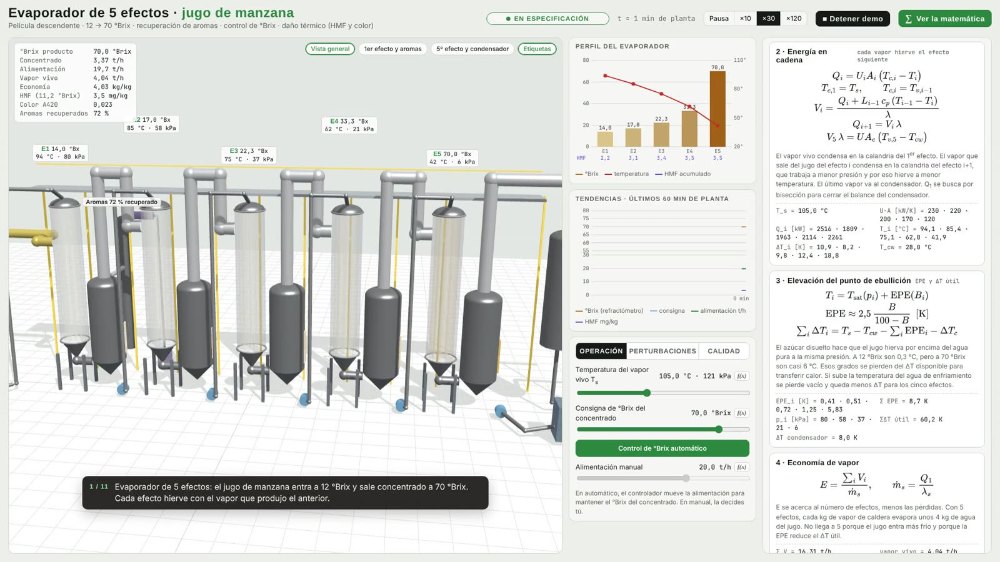
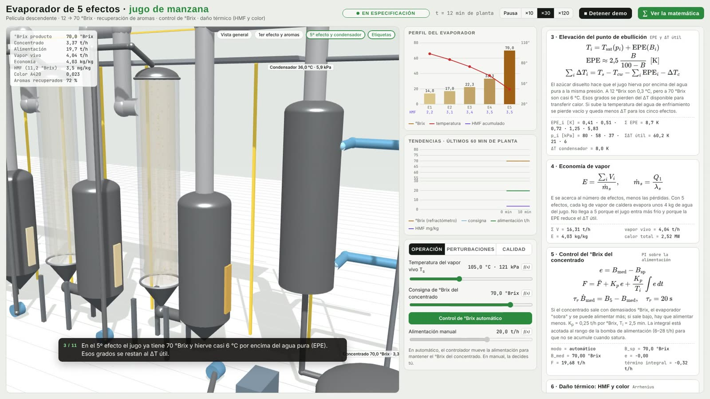

# Evaporador de 5 efectos para jugo de manzana · con daño térmico y calidad

[English version](README.md)

Simulador 3D de un evaporador de película descendente de 5 efectos, del tipo usado en las jugueras para concentrar jugo de manzana de 12 a 70 °Brix. Incluye:
- balances de masa, sólidos y energía en cadena por efecto;
- elevación del punto de ebullición;
- economía de vapor;
- control automático del °Brix del concentrado;
- recuperación de aromas en el primer efecto;
- **daño térmico**: formación de HMF y pardeamiento (color) por Arrhenius, efecto por efecto y en el tanque de producto.

 

## Cómo abrirlo

Abre `evaporador.html` en el navegador con doble clic. three.js y MathJax están incluidos en `vendor/`, así que funciona sin internet.

- **Velocidad:** el tiempo de planta corre ×30 por defecto (un minuto de planta cada 2 segundos). Hay opciones ×10 y ×120.
- **"▶ Demo guiada":** reproduce una secuencia guiada con subtítulos.
- **"∑ Ver la matemática":** abre el panel con las ecuaciones y sus valores en vivo.

| Pestaña | Qué se puede mover |
|---|---|
| **Operación** | Temperatura del vapor vivo, consigna de °Brix, control automático o manual, alimentación manual |
| **Perturbaciones** | Ensuciamiento de tubos y limpieza CIP, temperatura del agua del condensador (vacío), °Brix del jugo de alimentación |
| **Calidad** | Enfriador de concentrado en servicio o fuera, tiempo en el tanque de producto |

Lo que se ve en 3D:
- **Calandrias:** las 5 son transparentes, con el jugo cayendo en película por los tubos. Su color va del amarillo pálido al ámbar según el °Brix, y se oscurece con el pardeamiento.
- **Separadores, ductos y bombas:** los separadores tienen visor de nivel; por los ductos de vapor pasa el vapor de un efecto al siguiente, y las bombas trasladan el jugo entre efectos.
- **Resto de la planta:** la caldera y el vapor vivo, la columna de aromas, el condensador con agua de enfriamiento y bomba de vacío, el enfriador de placas y el tanque de concentrado.
- **Etiquetas:** cada efecto muestra su °Brix, temperatura y presión.

Experimentos sugeridos:

1. **Más vapor = más capacidad, peor calidad:** sube $T_s$ de 105 a 115 °C. El control procesa unos 2,5 t/h más de jugo, pero el HMF pasa de 3,5 a unos 7 mg/kg.
2. **Ensuciamiento:** con 35 % el °Brix cae y el control baja la alimentación de 19,7 a unos 15 t/h. La limpieza CIP lo recupera.
3. **Pérdida de vacío:** con el agua de enfriamiento a 38 °C, suben todas las temperaturas, baja la capacidad y sube el HMF.
4. **Tanque caliente:** saca de servicio el enfriador y sube el tiempo en el tanque. El color pasa el límite, porque a 70 °Brix el pardeamiento es rápido aunque la temperatura sea moderada.
5. **Control en manual:** pasa el control a manual y cambia el °Brix de alimentación. El concentrado se va de especificación hasta que corriges el caudal a mano.

---

## 1. Balance de masa y de sólidos

Configuración en paralelo: el jugo y el vapor recorren los efectos en el mismo sentido (1 → 5). Para cada efecto $i$:

$$
L_i = L_{i-1} - V_i, \qquad L_0 = F
$$

$$
M_i\,\frac{dx_i}{dt} = L_{i-1}\,(x_{i-1} - x_i) + V_i\,x_i, \qquad x_0 = \frac{B_f}{100}
$$

Donde:
- $L_i$ es el caudal de jugo que sale del efecto $i$;
- $V_i$ es el vapor evaporado en el efecto $i$;
- $x_i$ es la fracción de sólidos solubles;
- $M_i$ es la masa retenida, que es pequeña en película descendente (300, 250, 200, 150 y 120 kg).

El concentrado sale con un caudal $P = F\,x_0/x_5$.

## 2. Energía en cadena

El vapor vivo condensa en la calandria del 1er efecto. El vapor que sale del jugo del efecto $i$ condensa en la calandria del efecto $i+1$:

$$
Q_i = U_iA_i\,(T_{c,i} - T_i), \qquad T_{c,1} = T_s, \quad T_{c,i} = T_{v,i-1}
$$

$$
V_i = \frac{Q_i + L_{i-1}\,c_p\,(T_{i-1} - T_i)}{\lambda}, \qquad Q_{i+1} = V_i\,\lambda
$$

El término $L_{i-1}c_p(T_{i-1} - T_i)$ tiene dos efectos:
- en el 1er efecto, calienta la alimentación, que entra a 60 °C;
- en los siguientes, produce *flash*, porque el jugo llega más caliente que la temperatura de ebullición del efecto.

El último vapor va al condensador:

$$
V_5\,\lambda = UA_c\,(T_{v,5} - T_{cw})
$$

**Solución:** con $Q_1$ dado se recorre toda la cadena y se obtiene el residuo del condensador, $r(Q_1) = V_5\lambda - UA_c(T_{v,5} - T_{cw})$. Ese residuo crece con $Q_1$, así que $Q_1$ se encuentra por **bisección** en cada paso. Las temperaturas y las presiones salen de esa misma cadena.

### Límites físicos de operación

- **Viscosidad:** cerca de 80 °Brix el jugo se vuelve muy viscoso y el coeficiente de transferencia cae. Cada $U_iA_i$ se
  multiplica por un factor logístico del °Brix del efecto: $1/(1 + e^{(x_i - 0{,}83)/0{,}03})$. Así la evaporación se
  autolimita de forma suave.
- **Caudal mínimo de mojado:** 10 t/h. Por debajo, los tubos de película descendente se secan.
- **Enclavamiento de °Brix alto:** si el concentrado supera 76 °Brix, se fuerza más alimentación, también con el control
  en manual, como hacen las plantas para no quemar el producto. Más allá de unos 78 °Brix el modelo de energía en
  cadena deja de tener una solución única, así que la simulación no se lleva a esa zona.

## 3. Elevación del punto de ebullición (EPE) y ΔT útil

El jugo hierve por encima del agua pura a la misma presión:

$$
T_i = T_{\text{sat}}(p_i) + \text{EPE}(B_i), \qquad \text{EPE} \approx 2{,}5\,\frac{B}{100 - B}\ \ [\text{K}]
$$

Son 0,3 K a 12 °Brix, 1,7 K a 40 °Brix y 5,8 K a 70 °Brix. Es la ley ebulloscópica de una solución ideal, $\Delta T = K_b\,m$, con $K_b$ = 0,512 K·kg/mol del agua y una masa molar media de los azúcares de unos 205 g/mol (fructosa, glucosa y sacarosa). $T_{\text{sat}}$ sale de la ecuación de Antoine para el agua. El ΔT disponible para transferir calor es

$$
\sum_i \Delta T_i = T_s - T_{cw} - \sum_i \text{EPE}_i - \Delta T_c
$$

Por eso perder vacío (agua de enfriamiento más caliente) o concentrar más reduce la capacidad.

## 4. Economía de vapor

$$
E = \frac{\sum_i V_i}{\dot m_s}, \qquad \dot m_s = \frac{Q_1}{\lambda_s}
$$

Con 5 efectos, $E \approx$ 4,0: cada kg de vapor de caldera evapora unos 4 kg de agua del jugo. No llega a 5 por dos motivos: el calentamiento de la alimentación en el 1er efecto y el ΔT que se pierde por la EPE.

## 5. Control del °Brix del concentrado

Un refractómetro en línea mide el °Brix con un retardo de primer orden:

$$
\tau_r\,\dot B_{\text{med}} = B_5 - B_{\text{med}}, \qquad \tau_r = 20\ \text{s}
$$

Un PI mueve el caudal de alimentación:

$$
e = B_{\text{med}} - B_{\text{sp}}, \qquad F = \bar F + K_p\,e + \frac{K_p}{T_i}\int e\,dt
$$

Los parámetros son $K_p$ = 0,25 t/h por °Brix y $T_i$ = 2,5 min. La integral está acotada al rango de la bomba (10–28 t/h), como protección contra el windup. La sintonía se eligió comparando el error absoluto integrado frente a ensuciamiento y pérdida de vacío: con $K_p$ = 0,07 kg/s y $T_i$ = 150 s, el °Brix vuelve a la consigna en 5 a 10 minutos de planta.

## 6. Daño térmico: HMF y color

El hidroximetilfurfural (HMF) y el pardeamiento no enzimático se forman según la temperatura, la concentración de azúcares y el tiempo. La velocidad de formación, por kg de sólidos solubles, es

$$
r(T, x) = k_0\,\exp\!\left[-\frac{E_a}{R}\left(\frac{1}{T} - \frac{1}{T_{\text{ref}}}\right)\right] e^{\,3\,(x - 0{,}12)}, \qquad T_{\text{ref}} = 90\ °\text{C}
$$

| Indicador | $k_0$ | $E_a$ | Aumento cada 10 °C |
|---|---|---|---|
| HMF | 0,18 mg/(kg·s) | 130 kJ/mol | ≈ ×3 |
| Color A420 | 1,1·10⁻³ 1/s | 100 kJ/mol | ≈ ×2,4 |

Se lleva $h_i$, el HMF por kg de sólidos, para que concentrar (quitar agua) no "cree" HMF. Solo cuenta el que se forma:

$$
\frac{dh_i}{dt} = \frac{L_{i-1}x_{i-1}}{M_i x_i}\,(h_{i-1} - h_i) + r_H(T_i, x_i)
$$

El color se calcula igual. El producto pasa además un tiempo $t_{\text{tq}}$ en el tanque, a 10 °C si el enfriador está en servicio o a la temperatura del 5º efecto si no:

$$
\text{HMF}_{11{,}2} = 0{,}112\,\Big[h_5 + r_H(T_{\text{tq}}, x_5)\,t_{\text{tq}}\Big]
$$

El factor 0,112 refiere el valor al jugo reconstituido a 11,2 °Brix.

**Límites de la demo:** HMF ≤ 10 mg/kg, que es la referencia del código AIJN para manzana, y un índice de color ≤ 0,040, que es ilustrativo. Las constantes cinéticas están calibradas para dar valores típicos (unos 3,5 mg/kg de HMF en operación normal) y para mostrar las tendencias correctas: casi todo el HMF se forma en los efectos calientes, y el tanque sin enfriar daña sobre todo el color. No reemplazan una cinética medida en laboratorio para un jugo en particular.

## 7. Recuperación de aromas

Los ésteres y aldehídos de la manzana son mucho más volátiles que el agua y salen con el primer vapor:

$$
\eta_{\text{aroma}} = 1 - \exp\!\left(-\alpha\,\frac{V_1}{F}\right), \qquad \alpha \approx 9
$$

Con un 14 % del jugo evaporado en el 1er efecto, se recupera alrededor del 72 % del aroma. Ese vapor va a una columna que concentra el aroma unas 150 veces, y el aroma se reincorpora al reconstituir el jugo.

## 8. Datos de la planta

| Parámetro | Valor |
|---|---|
| Alimentación de diseño | 20 t/h de jugo a 12 °Brix y 60 °C |
| Producto | ≈ 3,4 t/h de concentrado a 70 °Brix |
| Vapor vivo | 105 °C (121 kPa), ≈ 4 t/h |
| $U_iA_i$ | 230, 220, 200, 170 y 120 kW/K (baja con la viscosidad del jugo concentrado) |
| Condensador | $UA_c$ = 300 kW/K, agua de enfriamiento a 28 °C |
| Perfil típico | 94 / 85 / 75 / 62 / 42 °C · 80 / 57 / 37 / 20 / 6 kPa · 14 / 17 / 22 / 33 / 70 °Brix |
| $c_p$, $\lambda$ | 3,8 kJ/(kg·K), 2330 kJ/kg |
| Ensuciamiento | reduce $U_iA_i$ en 60 % del valor indicado en el 1er efecto y en 100 % en el 5º, porque los efectos concentrados se ensucian más |

### Simplificaciones del modelo

- **EPE sin corrección por presión.** Se usa el $K_b$ del agua a presión atmosférica en todos los efectos. Como $K_b \propto T_b^2/\lambda$, a los 6 kPa del 5º efecto la EPE real sería alrededor de un 30 % menor. A alta concentración la solución deja de ser ideal y eso la aumenta, así que los dos efectos se compensan en parte.
- **Calor latente constante** (2330 kJ/kg). En realidad va de unos 2270 kJ/kg a 94 °C a 2415 kJ/kg a 36 °C, un ±3 %.
- **Factor de concentración de la cinética**, $e^{3(x-0{,}12)}$: es una forma empírica para que el daño crezca con los °Brix, como se observa en los concentrados. Igual que $k_0$, está calibrado y no medido.
- **Aromas:** la expresión exponencial es la destilación de Rayleigh para un componente diluido, con $\alpha$ como volatilidad relativa efectiva. El valor 9 es una calibración, no un dato de un aroma en particular.
- **Condensador** con temperatura de agua constante y **calandrias** sin dinámica térmica (ver abajo).

## 9. Integración numérica

- **Paso:** 0,5 s de planta, con Euler explícito para los sólidos, el HMF y el color.
- **Energía:** cuasi estacionaria, porque se resuelve por bisección en cada paso. La dinámica térmica de las calandrias es mucho más rápida que la de concentración.

## Archivos

- `evaporador.html`: el simulador completo.
- `vendor/`: three.js r128 (MIT) y MathJax 3.2.2 (Apache 2.0).
