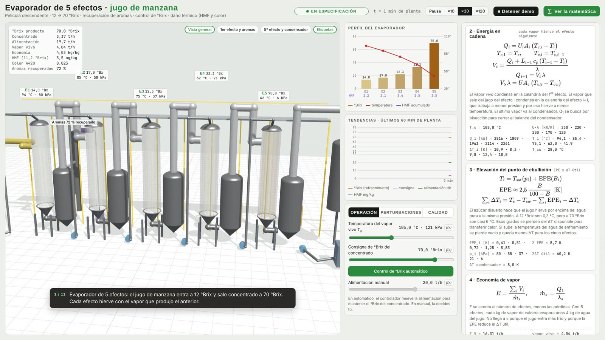
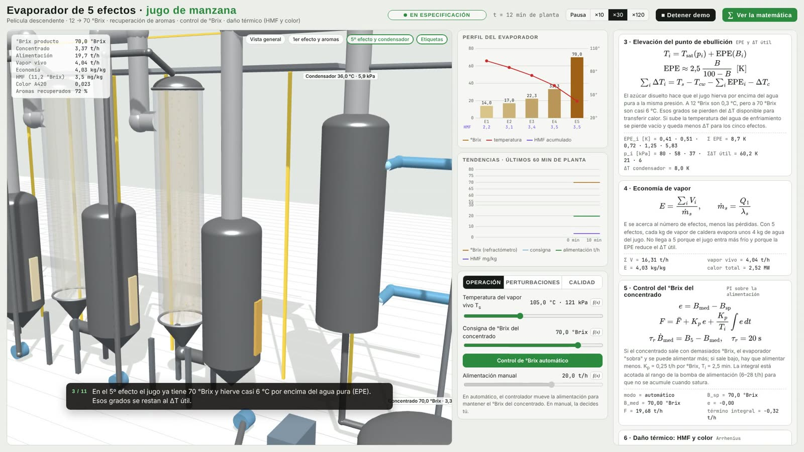

# 5-effect apple juice evaporator · with thermal damage and quality

[Versión en español](README.es.md)

3D simulator of a 5-effect falling-film evaporator, the type used in juice plants to concentrate apple juice from 12 to 70 °Brix. It includes:
- chained mass, solids and energy balances per effect;
- boiling-point elevation;
- steam economy;
- automatic control of the concentrate °Brix;
- aroma recovery in the first effect;
- **thermal damage**: HMF formation and browning (colour) by Arrhenius, effect by effect and in the product tank.

 

## How to open it

Open `evaporador.html` in a browser with a double click. three.js and MathJax are bundled in `vendor/`, so it works offline.

- **Speed:** plant time runs ×30 by default (one plant minute every 2 seconds). ×10 and ×120 are also available.
- **"▶ Guided demo":** plays a guided sequence with captions.
- **"∑ Show the math":** opens the panel with the equations and their live values.

| Tab | What can be changed |
|---|---|
| **Operation** | Live steam temperature, °Brix setpoint, automatic or manual control, manual feed |
| **Disturbances** | Tube fouling and CIP cleaning, condenser water temperature (vacuum), feed juice °Brix |
| **Quality** | Concentrate cooler in or out of service, time in the product tank |

What the 3D view shows:
- **Calandrias:** all 5 are transparent, with juice falling as a film through the tubes. Its colour goes from pale yellow to amber with °Brix and darkens with browning.
- **Separators, ducts and pumps:** separators have a level gauge; vapour flows through the ducts from one effect to the next, and pumps move the juice between effects.
- **Rest of the plant:** the boiler and live steam, the aroma column, the condenser with cooling water and vacuum pump, the plate cooler and the concentrate tank.
- **Tags:** each effect shows its °Brix, temperature and pressure.

Suggested experiments:

1. **More steam = more capacity, worse quality:** raise $T_s$ from 105 to 115 °C. The controller processes about 2.5 t/h more juice, but HMF goes from 3.5 to about 7 mg/kg.
2. **Fouling:** at 35 % the °Brix drops and the controller lowers the feed from 19.7 to about 15 t/h. CIP cleaning recovers it.
3. **Vacuum loss:** with cooling water at 38 °C, all temperatures rise, capacity drops and HMF rises.
4. **Hot tank:** take the cooler out of service and increase the tank time. Colour exceeds the limit, because at 70 °Brix browning is fast even at moderate temperature.
5. **Manual control:** switch control to manual and change the feed °Brix. The concentrate goes off-spec until you correct the flow by hand.

---

## 1. Mass and solids balance

Forward-feed configuration: juice and vapour go through the effects in the same direction (1 → 5). For each effect $i$:

$$
L_i = L_{i-1} - V_i, \qquad L_0 = F
$$

$$
M_i\,\frac{dx_i}{dt} = L_{i-1}\,(x_{i-1} - x_i) + V_i\,x_i, \qquad x_0 = \frac{B_f}{100}
$$

Where:
- $L_i$ is the juice flow leaving effect $i$;
- $V_i$ is the vapour evaporated in effect $i$;
- $x_i$ is the soluble-solids fraction;
- $M_i$ is the hold-up mass, which is small in a falling film (300, 250, 200, 150 and 120 kg).

The concentrate leaves at a flow $P = F\,x_0/x_5$.

## 2. Chained energy balance

Live steam condenses in the calandria of the 1st effect. The vapour leaving the juice of effect $i$ condenses in the calandria of effect $i+1$:

$$
Q_i = U_iA_i\,(T_{c,i} - T_i), \qquad T_{c,1} = T_s, \quad T_{c,i} = T_{v,i-1}
$$

$$
V_i = \frac{Q_i + L_{i-1}\,c_p\,(T_{i-1} - T_i)}{\lambda}, \qquad Q_{i+1} = V_i\,\lambda
$$

The term $L_{i-1}c_p(T_{i-1} - T_i)$ has two effects:
- in the 1st effect, it heats the feed, which enters at 60 °C;
- in the following ones, it produces *flash*, because the juice arrives hotter than the effect's boiling temperature.

The last vapour goes to the condenser:

$$
V_5\,\lambda = UA_c\,(T_{v,5} - T_{cw})
$$

**Solution:** for a given $Q_1$ the whole chain is computed and the condenser residual is obtained, $r(Q_1) = V_5\lambda - UA_c(T_{v,5} - T_{cw})$. That residual increases with $Q_1$, so $Q_1$ is found by **bisection** at every step. Temperatures and pressures come out of the same chain.

### Physical operating limits

- **Viscosity:** near 80 °Brix the juice becomes very viscous and the heat-transfer coefficient drops. Each $U_iA_i$ is
  multiplied by a logistic factor of the effect's °Brix: $1/(1 + e^{(x_i - 0.83)/0.03})$. Evaporation thus limits
  itself smoothly.
- **Minimum wetting rate:** 10 t/h. Below it, falling-film tubes run dry.
- **High-°Brix interlock:** if the concentrate exceeds 76 °Brix, more feed is forced, even in manual control, as plants
  do so the product does not burn. Beyond about 78 °Brix the chained energy model no longer has a unique solution, so
  the simulation is kept out of that region.

## 3. Boiling-point elevation (BPE) and useful ΔT

The juice boils above pure water at the same pressure:

$$
T_i = T_{\text{sat}}(p_i) + \text{BPE}(B_i), \qquad \text{BPE} \approx 2.5\,\frac{B}{100 - B}\ \ [\text{K}]
$$

That is 0.3 K at 12 °Brix, 1.7 K at 40 °Brix and 5.8 K at 70 °Brix. It is the ebullioscopic law for an ideal solution, $\Delta T = K_b\,m$, with $K_b$ = 0.512 K·kg/mol for water and a mean molar mass of the sugars of about 205 g/mol (fructose, glucose and sucrose). $T_{\text{sat}}$ comes from the Antoine equation for water. The ΔT available for heat transfer is

$$
\sum_i \Delta T_i = T_s - T_{cw} - \sum_i \text{BPE}_i - \Delta T_c
$$

That is why losing vacuum (warmer cooling water) or concentrating further reduces capacity.

## 4. Steam economy

$$
E = \frac{\sum_i V_i}{\dot m_s}, \qquad \dot m_s = \frac{Q_1}{\lambda_s}
$$

With 5 effects, $E \approx$ 4.0: each kg of boiler steam evaporates about 4 kg of water from the juice. It does not reach 5 for two reasons: feed heating in the 1st effect and the ΔT lost to BPE.

## 5. Concentrate °Brix control

An in-line refractometer measures °Brix with a first-order lag:

$$
\tau_r\,\dot B_{\text{meas}} = B_5 - B_{\text{meas}}, \qquad \tau_r = 20\ \text{s}
$$

A PI controller moves the feed flow:

$$
e = B_{\text{meas}} - B_{\text{sp}}, \qquad F = \bar F + K_p\,e + \frac{K_p}{T_i}\int e\,dt
$$

The parameters are $K_p$ = 0.25 t/h per °Brix and $T_i$ = 2.5 min. The integral is bounded to the pump range (10–28 t/h) as anti-windup protection. The tuning was chosen by comparing the integrated absolute error under fouling and vacuum loss: with $K_p$ = 0.07 kg/s and $T_i$ = 150 s, the °Brix returns to setpoint within 5 to 10 plant minutes.

## 6. Thermal damage: HMF and colour

Hydroxymethylfurfural (HMF) and non-enzymatic browning form depending on temperature, sugar concentration and time. The formation rate, per kg of soluble solids, is

$$
r(T, x) = k_0\,\exp\!\left[-\frac{E_a}{R}\left(\frac{1}{T} - \frac{1}{T_{\text{ref}}}\right)\right] e^{\,3\,(x - 0.12)}, \qquad T_{\text{ref}} = 90\ °\text{C}
$$

| Indicator | $k_0$ | $E_a$ | Increase per 10 °C |
|---|---|---|---|
| HMF | 0.18 mg/(kg·s) | 130 kJ/mol | ≈ ×3 |
| Colour A420 | 1.1·10⁻³ 1/s | 100 kJ/mol | ≈ ×2.4 |

The model tracks $h_i$, HMF per kg of solids, so that concentrating (removing water) does not "create" HMF. Only what forms counts:

$$
\frac{dh_i}{dt} = \frac{L_{i-1}x_{i-1}}{M_i x_i}\,(h_{i-1} - h_i) + r_H(T_i, x_i)
$$

Colour is computed the same way. The product also spends a time $t_{\text{tank}}$ in the tank, at 10 °C if the cooler is in service or at the 5th-effect temperature if not:

$$
\text{HMF}_{11.2} = 0.112\,\Big[h_5 + r_H(T_{\text{tank}}, x_5)\,t_{\text{tank}}\Big]
$$

The factor 0.112 refers the value to juice reconstituted at 11.2 °Brix.

**Demo limits:** HMF ≤ 10 mg/kg, the AIJN code of practice reference for apple, and a colour index ≤ 0.040, which is illustrative. The kinetic constants are calibrated to give typical values (about 3.5 mg/kg of HMF in normal operation) and to show the right trends: almost all HMF forms in the hot effects, and an uncooled tank mostly damages colour. They do not replace kinetics measured in the lab for a specific juice.

## 7. Aroma recovery

Apple esters and aldehydes are far more volatile than water and leave with the first vapour:

$$
\eta_{\text{aroma}} = 1 - \exp\!\left(-\alpha\,\frac{V_1}{F}\right), \qquad \alpha \approx 9
$$

With 14 % of the juice evaporated in the 1st effect, about 72 % of the aroma is recovered. That vapour goes to a column that concentrates the aroma about 150 times, and the aroma is added back when the juice is reconstituted.

## 8. Plant data

| Parameter | Value |
|---|---|
| Design feed | 20 t/h of juice at 12 °Brix and 60 °C |
| Product | ≈ 3.4 t/h of concentrate at 70 °Brix |
| Live steam | 105 °C (121 kPa), ≈ 4 t/h |
| $U_iA_i$ | 230, 220, 200, 170 and 120 kW/K (lower with the viscosity of concentrated juice) |
| Condenser | $UA_c$ = 300 kW/K, cooling water at 28 °C |
| Typical profile | 94 / 85 / 75 / 62 / 42 °C · 80 / 57 / 37 / 20 / 6 kPa · 14 / 17 / 22 / 33 / 70 °Brix |
| $c_p$, $\lambda$ | 3.8 kJ/(kg·K), 2330 kJ/kg |
| Fouling | reduces $U_iA_i$ by 60 % of the set value in the 1st effect and by 100 % in the 5th, because concentrated effects foul more |

### Model simplifications

- **BPE without pressure correction.** The $K_b$ of water at atmospheric pressure is used in every effect. Since $K_b \propto T_b^2/\lambda$, at the 6 kPa of the 5th effect the real BPE would be about 30 % lower. At high concentration the solution is no longer ideal, which increases it, so the two effects partly cancel.
- **Constant latent heat** (2330 kJ/kg). In reality it goes from about 2270 kJ/kg at 94 °C to 2415 kJ/kg at 36 °C, ±3 %.
- **Concentration factor in the kinetics**, $e^{3(x-0.12)}$: an empirical form so damage grows with °Brix, as observed in concentrates. Like $k_0$, it is calibrated, not measured.
- **Aromas:** the exponential expression is Rayleigh distillation for a dilute component, with $\alpha$ as an effective relative volatility. The value 9 is a calibration, not data for a specific aroma.
- **Condenser** with constant water temperature and **calandrias** without thermal dynamics (see below).

## 9. Numerical integration

- **Step:** 0.5 s of plant time, with explicit Euler for solids, HMF and colour.
- **Energy:** quasi-steady, since it is solved by bisection at every step. The thermal dynamics of the calandrias are much faster than the concentration dynamics.

## Files

- `evaporador.html`: the complete simulator.
- `vendor/`: three.js r128 (MIT) and MathJax 3.2.2 (Apache 2.0).
