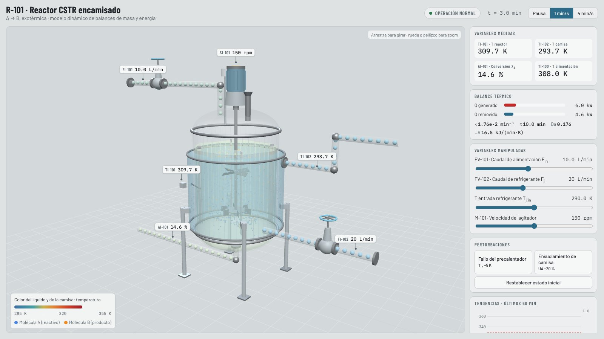
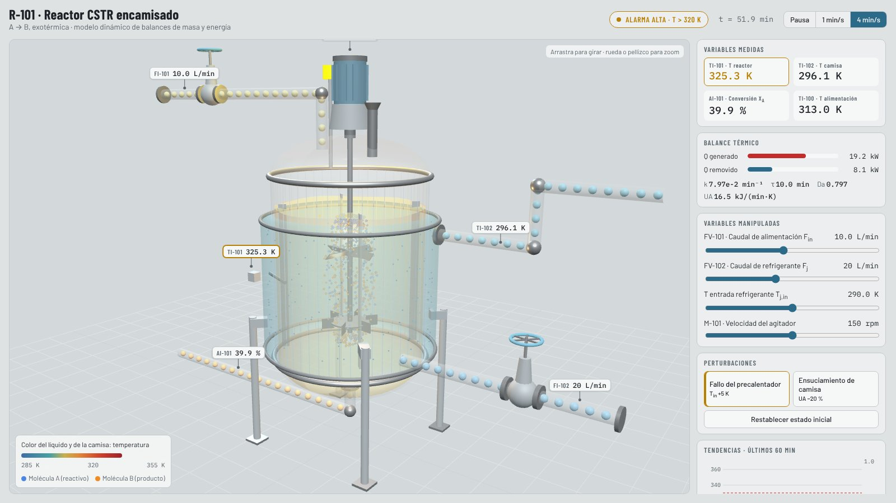

# Reactor CSTR R-101 · HMI de entrenamiento con vista 3D

[English version](README.md)

<p> </p>

Reactor continuo de tanque agitado (CSTR) encamisado con una reacción exotérmica A → B. El modelo
(`cstr_model.py`) integra los balances de masa y energía con RK4, agrega ruido de medición y define las alarmas.
La HMI en Dash (`app.py`, estilo ISA-101) envía el estado en cada paso a la vista 3D (`assets/cstr_3d.html`, three.js).

| Elemento 3D | Qué muestra |
|---|---|
| Color del líquido y de la camisa | Temperatura del reactor T y de la camisa T_j |
| Agitador y vórtice | Velocidad del agitador, que también cambia el coeficiente UA |
| Moléculas azules / naranjas | A que se convierte en B con la misma cinética de Arrhenius; la fracción naranja sigue a X_A |
| Esferas en cañerías y camisa | Caudal de alimentación F_in y de refrigerante F_j, coloreadas por temperatura |
| Válvulas FV-101 / FV-102 | Volante y vástago según la apertura |
| Etiquetas de instrumentos | TI-101, TI-102, AI-101, FI-101, FI-102, SI-101 con ruido de medición |
| Baliza, brillo y vapor | Ámbar sobre 320 K; rojo intermitente y vapor sobre 330 K (fuga térmica) |

## Cómo usarlo

```bash
pip install -r requirements.txt
python hmi/app.py
```

Se abre en `http://127.0.0.1:8050`. La página `assets/cstr_3d.html` también funciona sola, con su propia simulación
y panel de control.

## Parámetros

C_A,in = 4 mol/L, T_in = 308 K, V = 100 L, V_j = 20 L, ΔH_r = −60 kJ/mol, Ea = 83,14 kJ/mol. k0 y UA se calculan
para que el caso base (F_in = 10 L/min, F_j = 20 L/min, T_j,in = 290 K, 150 rpm) sea un estado estacionario estable
con T = 310 K y X_A = 0,15. Con la falla del precalentador (+5 K) y sin acción del operador, el reactor se dispara a
unos 339 K; subiendo F_j a 40 L/min y bajando T_j,in a 285 K vuelve a unos 316 K.

Fundamentos teóricos: [`../CSTR_Fundamentals.md`](../CSTR_Fundamentals.md).
