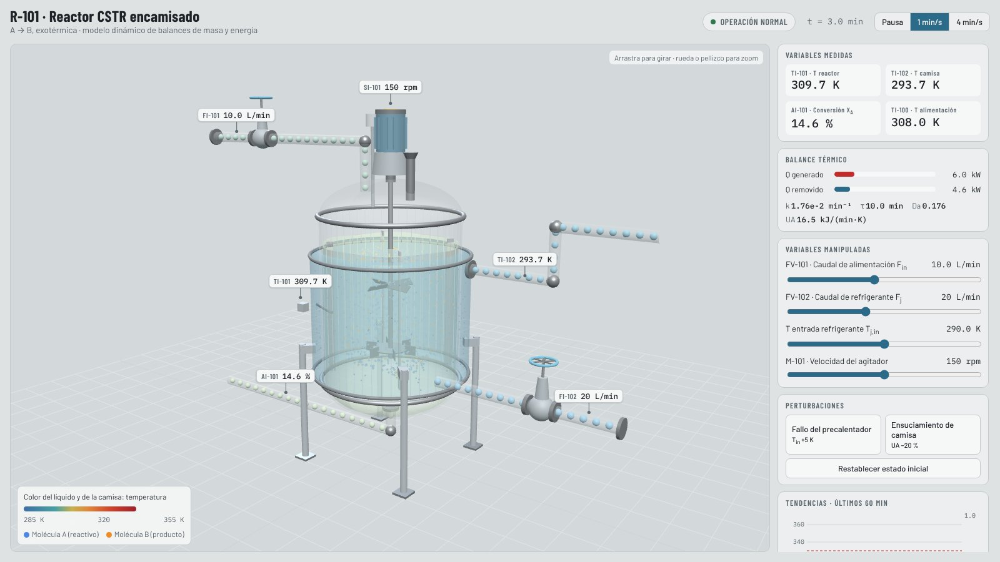
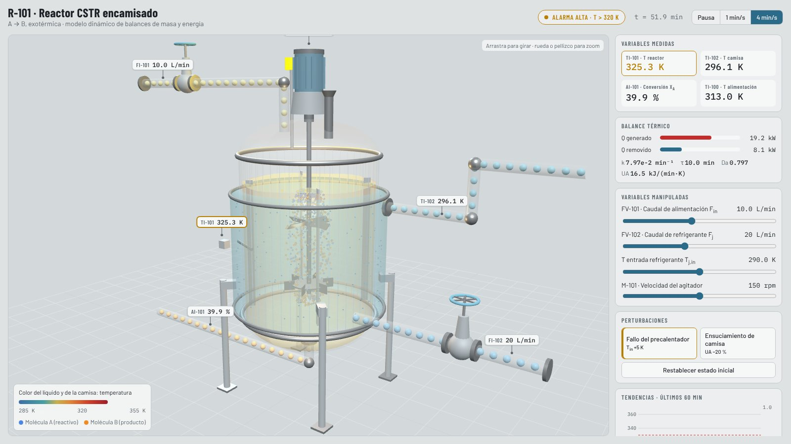

# CSTR reactor R-101 · training HMI with a 3D view

[Versión en español](README.es.md)

<p> </p>

Jacketed continuous stirred tank reactor (CSTR) with an exothermic reaction A → B. The model
(`cstr_model.py`) integrates the mass and energy balances with RK4, adds measurement noise and defines the alarms.
The Dash HMI (`app.py`, ISA-101 style) sends the state at every step to the 3D view (`assets/cstr_3d.html`, three.js).

| 3D element | What it shows |
|---|---|
| Liquid and jacket colour | Reactor temperature T and jacket temperature T_j |
| Agitator and vortex | Agitator speed, which also changes the heat-transfer coefficient UA |
| Blue / orange molecules | A turning into B with the same Arrhenius kinetics; the orange share follows X_A |
| Spheres in pipes and jacket | Feed flow F_in and coolant flow F_j, coloured by temperature |
| Valves FV-101 / FV-102 | Hand-wheel and stem follow the valve opening |
| Instrument tags | TI-101, TI-102, AI-101, FI-101, FI-102, SI-101 with measurement noise |
| Beacon, glow and vapour | Amber above 320 K; flashing red and vapour above 330 K (thermal runaway) |

## How to use it

```bash
pip install -r requirements.txt
python hmi/app.py
```

It opens at `http://127.0.0.1:8050`. The page `assets/cstr_3d.html` also works on its own, with its own simulation
and control panel.

## Parameters

C_A,in = 4 mol/L, T_in = 308 K, V = 100 L, V_j = 20 L, ΔH_r = −60 kJ/mol, Ea = 83.14 kJ/mol. k0 and UA are computed
so that the base case (F_in = 10 L/min, F_j = 20 L/min, T_j,in = 290 K, 150 rpm) is a stable steady state
with T = 310 K and X_A = 0.15. With the preheater failure (+5 K) and no operator action, the reactor runs away to
about 339 K; raising F_j to 40 L/min and lowering T_j,in to 285 K brings it back to about 316 K.

Theory: [`../CSTR_Fundamentals.md`](../CSTR_Fundamentals.md).
