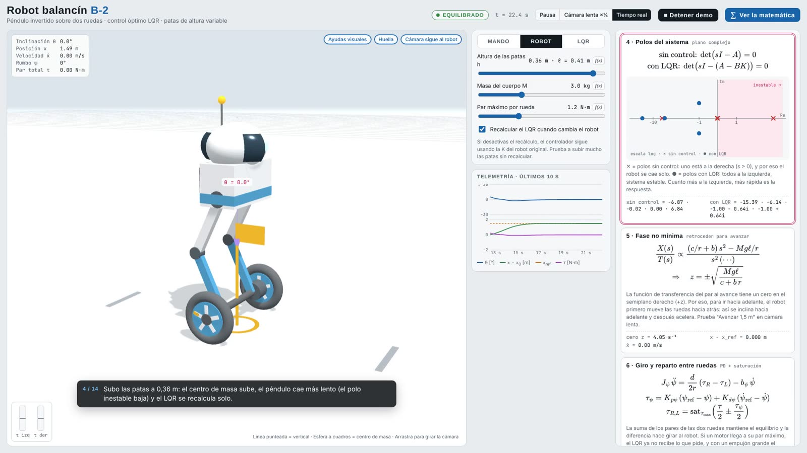
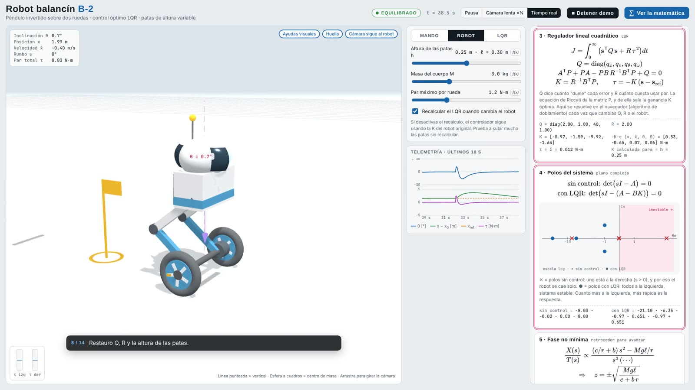

# B-2 self-balancing robot · two-wheeled inverted pendulum with LQR control

[Versión en español](README.es.md)

Interactive simulator of a two-wheeled self-balancing robot with adjustable legs. The physics is nonlinear, the control is optimal (LQR) and it is computed in the browser itself. The 3D scene (three.js) shows the robot, the vertical, the angle θ, the centre of mass, the torque on each wheel and the footprint on the ground. The **"∑ Show the math"** panel shows the equations in this document with their live values, including the **system poles in the complex plane**. When a control moves, the equation and the term that changes are highlighted in pink.

 

## How to open it

Open `robot.html` in a browser with a double click. three.js and MathJax are bundled in `vendor/`, so it works offline. The **"▶ Guided demo"** button plays a guided sequence with captions.

| Tab | What can be changed |
|---|---|
| **Drive** | Stand still, move forward 1.5 m, go and come back, figure eight, free driving (speed and turn); normal and strong push; lift the robot |
| **Robot** | Leg height $h$, body mass $M$, maximum torque per wheel; option to not recompute the LQR |
| **LQR** | Weights $q_x, q_v, q_\theta, q_\omega$ and $R$ (log scale); shows the gain $K$ |

Suggested experiments:

1. **Non-minimum phase:** set slow motion ×¼ and "Move forward 1.5 m". The wheels roll back about 3 cm before moving forward.
2. **Height and stability:** raising the legs moves the unstable pole toward the origin. A taller pendulum falls more slowly and is easier to balance.
3. **LQR not recomputed:** turn off "Recompute LQR", raise the legs to the maximum and push. The old K is no longer optimal for that robot.
4. **Large R:** with $R$ = 100 the controller saves torque. The poles move toward the imaginary axis and the response becomes slow and wide.
5. **Saturation:** with 1.2 N·m per wheel the "strong push" knocks it over. With 3 N·m it recovers.

---

## 1. Model

Generalized coordinates:
- $x$: wheel travel, with $x = r\,\varphi$ (rolling without slipping).
- $\theta$: body tilt from the vertical, positive forward.

The body, of mass $M$, has its centre of mass at a distance $\ell = h + 0.05$ m from the wheel axle. Each wheel has mass $m_w$, radius $r$ and inertia $I_w = \tfrac12 m_w r^2$.

The motor applies a torque $\tau$ **between the body and the wheels**. On the wheels it produces a forward force $\tau/r$, and on the body a reaction $-\tau$.

### Lagrange equations

Kinetic and potential energy:

$$
\mathcal T = \tfrac12 a\,\dot x^2 + b\cos\theta\,\dot x\,\dot\theta + \tfrac12 c\,\dot\theta^2,
\qquad
\mathcal V = M g \ell \cos\theta
$$

with

$$
a = M + 2m_w + \frac{2I_w}{r^2}, \qquad b = M\ell, \qquad c = I_b + M\ell^2, \qquad I_b = 0.25\,M\ell^2
$$

From $\frac{d}{dt}\frac{\partial\mathcal L}{\partial\dot q} - \frac{\partial\mathcal L}{\partial q} = Q_q$ the nonlinear model follows:

$$
\begin{bmatrix} a & b\cos\theta \\ b\cos\theta & c \end{bmatrix}
\begin{bmatrix}\ddot x\\ \ddot\theta\end{bmatrix} =
\begin{bmatrix} \tau/r - b_x\dot x + b\sin\theta\,\dot\theta^2 \\ M g \ell\sin\theta - \tau \end{bmatrix}
$$

The simulator solves this 2×2 system at every step (without linearizing). $b_x$ is the rolling friction.

## 2. Linearization and state space

With $\sin\theta \approx \theta$, $\cos\theta \approx 1$ and $\dot\theta^2 \approx 0$, and writing $\Delta = ac - b^2$:

$$
\mathbf s = \begin{bmatrix} x & \dot x & \theta & \dot\theta \end{bmatrix}^{\mathsf T},
\qquad \dot{\mathbf s} = A\,\mathbf s + B\,\tau
$$

$$
A = \begin{bmatrix}
0 & 1 & 0 & 0 \\
0 & -\dfrac{c\,b_x}{\Delta} & -\dfrac{b\,Mg\ell}{\Delta} & 0 \\
0 & 0 & 0 & 1 \\
0 & \dfrac{b\,b_x}{\Delta} & \dfrac{a\,Mg\ell}{\Delta} & 0
\end{bmatrix},
\qquad
B = \begin{bmatrix} 0 \\ \dfrac{c/r + b}{\Delta} \\ 0 \\ -\dfrac{a + b/r}{\Delta} \end{bmatrix}
$$

Without control, the poles are the roots of $\det(sI - A) = 0$. With the default values ($M$ = 3 kg, $h$ = 0.25 m) they are approximately $\{-8.03;\; -0.02;\; 0;\; +8.00\}$. The pole at $+8$ rad/s is the inverted pendulum's: without control the robot falls in less than a second.

## 3. Optimal LQR control

The torque that minimizes

$$
J = \int_0^\infty \left( \mathbf s^{\mathsf T} Q\, \mathbf s + R\,\tau^2 \right) dt,
\qquad Q = \operatorname{diag}(q_x, q_v, q_\theta, q_\omega)
$$

is a linear state feedback:

$$
\tau = -K\,(\mathbf s - \mathbf s_{\text{ref}}), \qquad K = R^{-1} B^{\mathsf T} P
$$

where $P$ is the symmetric positive-definite solution of the **algebraic Riccati equation**:

$$
A^{\mathsf T}P + PA - PB\,R^{-1}B^{\mathsf T}P + Q = 0
$$

### How it is solved in the browser

1. The system is discretized with a small step, $\Delta t$ = 2 ms: $A_d \approx I + A\Delta t + \tfrac12 A^2\Delta t^2$, $B_d \approx B\Delta t + \tfrac12 AB\,\Delta t^2$, $Q_d = Q\,\Delta t$, $R_d = R\,\Delta t$. The discrete Riccati equation then tends to the continuous one.
2. The discrete Riccati equation is solved with the **structure-preserving doubling algorithm (SDA)**, which converges quadratically in about 20–30 iterations:

$$
\begin{aligned}
W_k &= (I + G_k H_k)^{-1} \\
A_{k+1} &= A_k W_k A_k \\
G_{k+1} &= G_k + A_k W_k G_k A_k^{\mathsf T} \\
H_{k+1} &= H_k + A_k^{\mathsf T} H_k W_k A_k
\end{aligned}
\qquad A_0 = A_d,\; G_0 = B_d R_d^{-1} B_d^{\mathsf T},\; H_0 = Q_d
$$

3. With $P = H_\infty$: $K = (R_d + B_d^{\mathsf T} P B_d)^{-1} B_d^{\mathsf T} P A_d$.

Plain Riccati iteration takes thousands of steps to converge for the slow position mode. With SDA the computation takes about 1 ms and is redone whenever $Q$, $R$, the height or the mass change.

With the default weights ($Q$ = diag(2, 1, 40, 1), $R$ = 2):

$$
K \approx \begin{bmatrix} -0.97 & -1.59 & -9.92 & -1.64 \end{bmatrix}
$$

The closed-loop poles, $\det(sI - (A - BK)) = 0$, are approximately $\{-21.1;\; -6.4;\; -0.97 \pm 0.65i\}$, all in the left half-plane.

**Practical details:**
- The position error $x - x_{\text{ref}}$ is limited to ±1 m, so a distant reference does not demand an exaggerated tilt.
- In the missions with speed (figure eight and free driving), $\mathbf s_{\text{ref}} = (x_{\text{ref}}, v_{\text{ref}}, 0, 0)$, with $x_{\text{ref}}$ integrating $v_{\text{ref}}$.

## 4. Non-minimum phase

Taking the Laplace transform of the linearized equations (without friction), the transfer function from torque to travel is

$$
\frac{X(s)}{T(s)} = \frac{(c/r + b)\,s^2 - Mg\ell/r}{s^2\left[(ac - b^2)\,s^2 - a\,Mg\ell\right]}
$$

It has zeros at

$$
z = \pm\sqrt{\frac{M g \ell}{c + b\,r}}
$$

The positive zero, about 4.6 s⁻¹ with the default values, makes the system **non-minimum phase**. To move forward, the robot first has to lean forward, and to do that it moves its wheels slightly **backward**. In the simulation, a 1.5 m step makes the wheels roll back about 3 cm before moving forward.

## 5. Turning and torque split between wheels

A torque difference between the wheels creates a difference of ground forces, separated by the track width $d$:

$$
J_\psi\,\ddot\psi = \frac{d}{2r}\,(\tau_R - \tau_L) - b_\psi\,\dot\psi
$$

$$
J_\psi = \frac{M\,(0.18^2 + 0.12^2)}{12} + 2 m_w \left(\frac d2\right)^2 + 2\cdot\tfrac14 m_w r^2
$$

Heading is controlled with a PD:

$$
\tau_\psi = K_{p\psi}\,(\psi_{\text{ref}} - \psi) + K_{d\psi}\,(\dot\psi_{\text{ref}} - \dot\psi), \qquad K_{p\psi} = 1.2,\; K_{d\psi} = 0.25
$$

Each wheel's torque combines balance and turning, and is saturated at the motor limit:

$$
\tau_{R,L} = \operatorname{sat}_{\tau_{\max}}\!\left(\frac{\tau}{2} \pm \frac{\tau_\psi}{2}\right)
$$

When a motor saturates, the total torque is no longer the one the LQR asks for. If the push is large, the robot cannot get under its centre of mass in time and falls. This is detected when $|\theta| > 66°$; the robot then rests at about 81°.

The position on the plane is obtained by integrating:

$$
\dot X = \dot x\cos\psi, \qquad \dot Y = \dot x\sin\psi
$$

## 6. Parameters

| Symbol | Value | Description |
|---|---|---|
| $r$ | 0.085 m | wheel radius |
| $m_w$ | 0.35 kg | mass of each wheel |
| $d$ | 0.34 m | distance between wheels |
| $M$ | 3.0 kg (1.5–6) | body mass |
| $h$ | 0.25 m (0.12–0.38) | leg height (hip to axle); $\ell = h + 0.05$ m |
| $I_b$ | $0.25\,M\ell^2$ | body inertia about its centre of mass |
| $b_x$ | 0.08 N·s/m | rolling friction |
| $b_\psi$ | 0.05 N·m·s | turning damping |
| $\tau_{\max}$ | 1.2 N·m per wheel (0.4–3) | maximum motor torque |
| $g$ | 9.81 m/s² | gravity |

## 7. Numerical integration

Semi-implicit Euler with a fixed 2 ms step: velocities are updated first and positions then use the new velocities. The poles in the panel come from the characteristic polynomial (Faddeev–LeVerrier method) and its roots from the Durand–Kerner method.

## Files

- `robot.html`: the complete simulator (model, LQR, 3D scene, equation panel and guided demo).
- `vendor/`: three.js r128 (MIT) and MathJax 3.2.2 (Apache 2.0).
